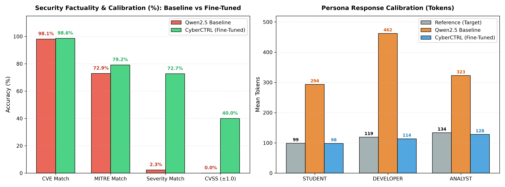

# CyberCTRL

**CyberCTRL** is a Domain-Adapted Cybersecurity Large Language Model for cybersecurity intelligence, threat triage, and role-conditioned guidance. It is optimized to deliver accurate vulnerability analysis, CVSS, severity scoring, and persona-calibrated responses (Security Analyst, Developer, Student).

---

## Tech Stack

- **Base Model**: Qwen2.5-3B-Instruct
- **Training**: Unsloth + TRL (Using QLoRA)
- **Evaluation**: ROUGE, BERTScore and custom CVE / MITRE / CVSS parsers

---

## Results

Evaluation was conducted over an unseen test split of **5,000 samples** comparing the out-of-the-box base model against CyberCTRL.

### 1. Cybersecurity Domain Factuality & Calibration

| Metric | Qwen2.5-3B Baseline | CyberCTRL | Absolute Gain |
| :--- | :---: | :---: | :---: |
| **CVE Exact Match Rate** | 98.11% | **98.57%** | +0.46% |
| **MITRE ATT&CK Match** | 72.92% | **79.17%** | +6.25% |
| **Severity Classification** | 2.32% | **72.70%** | **+70.38%** |
| **CVSS Within ±1.0 Band** | 0.00% | **39.97%** | **+39.97%** |

### 2. Standard Generation Metrics

| Metric | Qwen2.5-3B Baseline | CyberCTRL | Relative Improvement |
| :--- | :---: | :---: | :---: |
| **ROUGE-1** | 0.1635 | **0.6363** | +289% |
| **ROUGE-2** | 0.0316 | **0.5679** | +1,697% |
| **ROUGE-L** | 0.0922 | **0.6226** | +575% |
| **ROUGE-Lsum** | 0.1403 | **0.6253** | +346% |
| **BERTScore F1** | 0.8089 | **0.9183** | +13.5% |

### 3. Persona Response Calibration

The fine-tuned model successfully learned target token density and conciseness, eliminating the verbose rambling of the base model:

| Persona Target | Reference Length | Qwen2.5-3B Baseline | CyberCTRL |
| :--- | :---: | :---: | :---: |
| **Student** | 99 tokens | 294 tokens (+195) | **98 tokens (-1)** |
| **Developer** | 119 tokens | 462 tokens (+343) | **114 tokens (-5)** |
| **Analyst** | 134 tokens | 323 tokens (+189) | **128 tokens (-6)** |

---

## Insights

- **Vulnerability Risk Reasoning**: Base models recognize CVE and MITRE labels as text tokens, but struggle to evaluate exploitability and blast radius. Fine-tuning instills true risk calibration, enabling the model to assess vulnerability mechanics and map them accurately to severity tiers and CVSS scores.
- **Semantic Precision (BERTScore & ROUGE)**: The steep rise in BERTScore confirms deep conceptual alignment with expert references rather than surface-level memorization, replacing generic conversational filler with actionable, technically sound mitigations.
- **Audience-Targeted Substance**: Fine-tuning doesn't just enforce brevity—it dynamically shifts the technical focus by persona, delivering actionable code fixes for developers, rapid triage for SOC analysts, and foundational explanations for learners.
